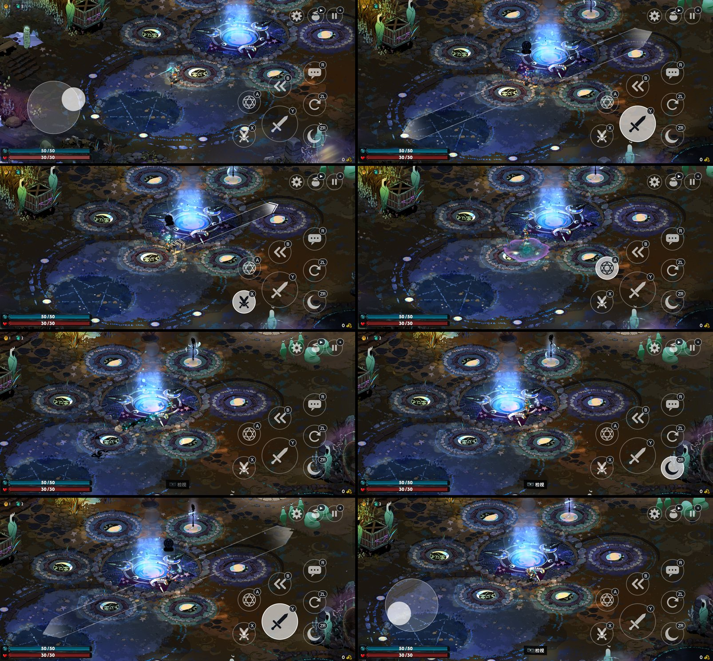

# n2a-hades — 哈迪斯 II 安卓原生移植（无模拟器）

[English](README.md)

把 **Nintendo Switch 版**《哈迪斯 II》（title ID `0100A00019DE0000`，更新 v9）原生移植到安卓。
Switch 二进制在构建期被改写，直接在手机 CPU 上运行；Switch 的系统服务和 NVN 图形接口则在 Android 与 Vulkan 之上重新实现。
中间没有模拟器、没有 JIT、没有虚拟机。

> **本仓库只提供底层适配，不包含游戏本体，以后也不会包含。**
> 仓库里没有任何游戏代码、资源、着色器、密钥或固件。你需要从自己拥有的 Switch 上导出游戏并自行准备文件
> （见 [准备你自己的游戏文件](#准备你自己的游戏文件)）。本项目与 Supergiant Games、任天堂没有任何关联，也未获其认可。

## 截图

在骁龙 8 Elite 手机上原生运行（屏幕 2640×1216，渲染 1562×720，约 60 FPS）：十字路口里的移动、攻击、特技、法阵、冲刺和巫咒，以及带 Switch 按键角标的触控按钮。游戏画面版权归 Supergiant Games 所有。



## 基于

本项目建立在 **[dodola/d2r-mobile](https://github.com/dodola/d2r-mobile)**（MIT 许可）之上，它是另一款 Switch 游戏的安卓/iOS 原生移植。
它的 NSO 改写器、Switch 系统 HLE 层、NVN→Vulkan 层、着色器翻译流水线和 APK 工具是本项目得以成立的基础；上游完整提交历史保留在本仓库中。
不得不修改的上游原文件，以相对上游提交 `62c6db8` 的补丁形式列在 [`dm/android/hades_patches/`](dm/android/hades_patches/README.md)。
上游的 README 与设计文档保存在 [`docs/upstream/`](docs/upstream/)，上游许可证见 [`LICENSE`](LICENSE)。

## 已实现的内容

- **针对哈迪斯 II 的 NSO 改写**（只用 `main` + `sdk`，不含 EOS/联网模块）：扩展了上游 `patch_nso.py`，处理本版本的 `mov sp, x18`（alloca）写法，并切除对 Epic Online Services 的依赖，游戏无需 EOS 即可启动并使用本地存档。
- **哈迪斯专用的 Switch 服务 HLE**（`dm/android/hades_hle.c`，带宿主侧测试）：`nn::ro` 桩、`nn::codec`（硬件 Opus 报告为不支持，使 FMOD 回退到软件解码）、`nn::fs` 目录计数、若干 `svc` 返回值、title ID 注册。共 48 个强制覆盖，宿主测试 1386 项检查。
- **NVN → Vulkan 补充**（`dm/gfx/nvn/hades_nvn.inc`、`nvn_vk.c`）：`DrawElements`、视口/深度范围、整数清除、纹理/采样器 builder 的 getter、BGRA8/BGR565/ASTC（全部块尺寸，原生上传）、线性（pitch）纹理、按池区分的纹理描述符表、把 32 位整数顶点属性当作浮点着色器输入，以及顶点缓冲读取范围收窄（游戏把顶点流绑定到 8 MiB 环形缓冲的末尾，只读每次绘制实际取用的部分后，战斗场景从约 29 FPS 提升到约 60 FPS）。
- **适合手机的触控操作**（`hades_pad.c`、`HadesPadView.java`）：只有一层。左侧浮动摇杆（菜单里也用它导航）；右侧小尺寸图标按钮（攻击、特殊、施法、冲刺、互动、呼唤、锁定），顶部是信息 / 暂停。菜单中施法键确认、冲刺键返回，不再有单独的菜单模式。界面中没有文字标签，也不出现主机按键名。
- **原生宽屏渲染**：加载时把游戏写死的 1280×720 窗口尺寸改写为手机比例（720 行高，例如 2640×1216 屏幕上为 1562×720），只对测试过的 `main` 版本生效并带指令校验，画面按宽屏原生渲染而不是拉伸；触控按键使用全宽。系统菜单里的“铺满全屏”开关（需重启）可切回 16:9 并留黑边。
- **宽屏 UI 布局**：引擎 Lua 从配置读窗口尺寸、会按 16:9 排版 UI。启动时本移植从你自己的 RomFS 镜像读 `Scripts/RunLogic.lua`，把那两处调用换成真实渲染尺寸，并通过 `hades-overlay` 覆盖（仓库不存任何游戏数据，任意手机比例都适用）。`dm/tools/hades2_lua_patch.py` 是离线版。
- **启动图标**：`dm/tools/hades2_icon.py` 从你自己的标题画面截图裁出 Logo 生成 `.local/icon-res`，`rebuild.sh` 有则自动使用。应用名：Hades Ⅱ。
- **系统信息显示**：系统菜单里的开关（默认关）在左上角显示帧率、本进程 CPU（及最忙线程）、按 Vulkan 时间戳估算的 GPU 占用（仅开启时统计）、显存与内存。不再常驻显示帧率。
- **工具**（`dm/tools/`、`scripts/`）：RomFS 镜像构建与校验、着色器缓存构建、可断点续传的 adb 推送（写入应用私有目录）、不依赖 Gradle 的 debug APK 打包、构建/运行/冒烟测试脚本。

### 真机已验证

启动 → 标题 → 新存档 → 据点 → 自由移动 → 过房间 → 战斗（受伤、特效、HUD）→ 死亡回据点 → 写入存档 → 重启应用 → 存档列表显示并可载入。
在已测场景中约 60 FPS（每帧约 640 次绘制）。

### 未完成 / 未验证

- 宽屏模式：已在 2.17:1 下验证世界、菜单、第一个战斗房间及其 HUD；其他 HUD/对话/Boss 场景未逐一验证（界面布局由引擎决定）。比 3.5:1 更宽的屏幕会被截断到该比例。
- 长时间游玩（内存增长、数小时稳定性）以及后续区域/Boss 尚未测试；游戏还可能调用其他未实现的 NVN 函数，届时会以 `Android NVN unsupported function` 中止。
- 游戏内按键提示仍显示 Switch 图标（如 “R”），对应上述屏幕按键。
- 音频已接通（FMOD 软件 Opus 路径，48 kHz 立体声），但没有用耳朵验证过。
- 只支持一个采样器描述符池；纹理 swizzle、primitive restart、sample mask 被忽略（只记一行日志）；`QueueWaitSync` 为空操作。
- 仅提供 debug 签名的 APK；应用要求游戏数据已放入其私有目录。

## 已测试环境

| | |
|---|---|
| 游戏导出 | 哈迪斯 II 基础包 `[0100A00019DE0000][v0].nsp` + 更新包 `[0100A00019DE0800][v589824].nsp`（即更新 **v9**；游戏内版本号 `v1.137848`）。使用的模块：`main`（build ID `8ce1ac48e9fa74479051f3520e632df4`）和 `sdk`（build ID `190030518b5d64e5d87b84bc54661af9`） |
| 主机系统 | Windows 11（shell 脚本用 Git Bash） |
| Android NDK | r27c（27.2.12479018），目标 `arm64-v8a`、`android-29` |
| Android SDK | platform `android-35`，build-tools `35.0.0` |
| JDK | OpenJDK 17.0.20 |
| CMake / Ninja | 3.31.6 / 1.12.1 |
| Python | 3.13（NSO 工具需要 `lz4`、`capstone`） |
| .NET SDK | 10.0.402（着色器翻译器 `dmsh_xlate`） |
| SPIR-V 校验器 | Vulkan SDK 中的 `spirv-val` |
| 手机 | 骁龙 8 Elite（SM8750）、Adreno 830、16 GB 内存、Android 16（API 36）、Vulkan 1.4、2640×1216 屏幕 |

## 目录结构

```
dm/android/            安卓宿主：JNI、音频、输入、GameActivity、哈迪斯 HLE（hades_hle.c）、触控板（hades_pad*.c）
dm/android/hades_patches/  对上游文件的补丁（相对上游 62c6db8）
dm/android/hades_test/ 哈迪斯 HLE 的宿主侧单元测试
dm/gfx/nvn/            NVN → Vulkan 层（含 hades_nvn.inc，哈迪斯专用 NVN 入口）
dm/host/               Switch 系统 HLE（svc、fs 等）
dm/tools/              NSO 改写器、RomFS / 着色器缓存 / APK / adb 推送工具
scripts/               配置 / 重建 / 运行 / 冒烟测试脚本（设置 N2A_TOOLS、ADB，见 scripts/env.sh）
docs/upstream/         上游 README、设计与贡献文档
.local/                被 git 忽略：你的游戏数据、密钥、构建产物、日志
```

## 准备你自己的游戏文件

下面全部使用**你自己的**导出文件。密钥、NSP、解出的文件和准备好的数据都不要放进版本控制（`.local/` 已被 git 忽略）。

1. 从你的 Switch 导出基础包和 v9 更新包，以及你自己的 `prod.keys`。用 `nstool`/`hactool` 解出更新包的 *Program* NCA（RomFS 需要基础包 NCA 配合），得到 `main`、`sdk` 两个 NSO 和合并后的 RomFS 目录树。
2. 改写模块：`python dm/tools/patch_nso.py <nso> <输出目录> main`，`sdk` 同理；用 `dm/tools/check_patched_nso.py <输出目录> main sdk` 检查。
3. 构建 RomFS 镜像：`python dm/tools/romfs_build.py <romfs 目录树> game.romfs`（用 `romfs_verify_tree.py` 校验）。
4. 翻译着色器：`python dm/tools/hades2_shader_cache.py --shaders <目录> --xlate <dmsh_xlate.dll> --dotnet <dotnet> --validator <spirv-val> --out <缓存目录>`。
5. 构建并安装 APK：`bash scripts/rebuild.sh`（把 `N2A_TOOLS` 指向包含 `ndk/ sdk/ jdk/ cmake/ ninja/` 的目录）。
6. 推送数据：`python dm/tools/hades2_push.py --modules <输出目录> --romfs game.romfs --shaders <缓存目录> --package org.hades2.mobile`。
7. 启动：`bash scripts/run_game.sh`（或直接打开应用）。`bash scripts/drive.sh` 是一个简单的冒烟测试。

哈迪斯 HLE 的宿主侧检查（需要 C 编译器，例如 `python -m ziglang cc`）：见 `dm/android/hades_test/hades_hle_test.c` 文件头。

## 许可

与上游一致，MIT（见 [`LICENSE`](LICENSE)），保留上游版权声明。《哈迪斯 II》及全部游戏内容归其各自权利人所有，本仓库不分发。
